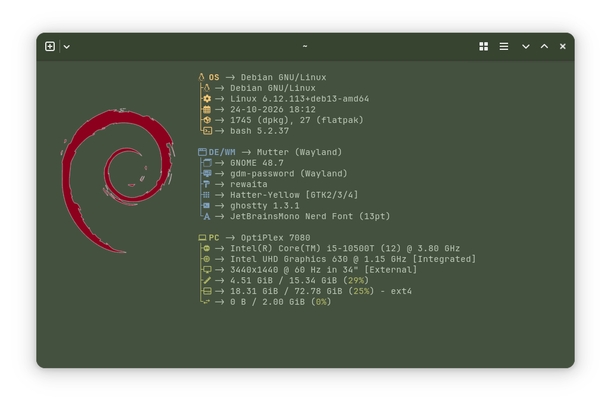
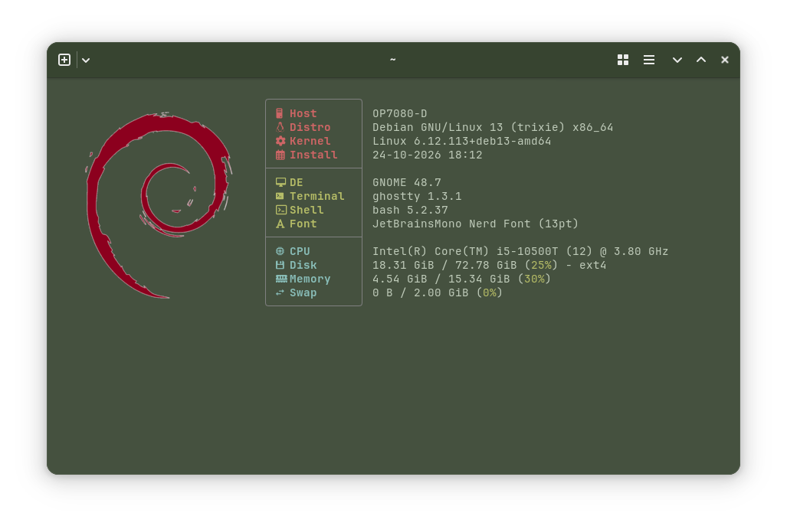
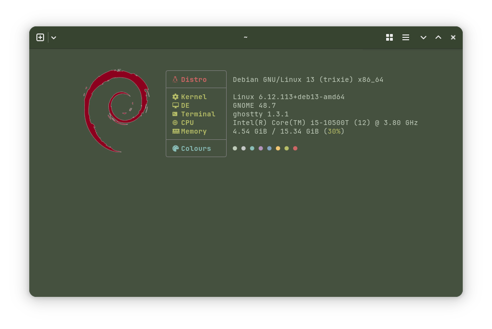

# Fastfetch 

<h3 align="left">
Welcome to my fastfetch config presets repository
</h3>

[Fastfetch](https://github.com/fastfetch-cli/fastfetch) is a command-line tool used to display system information and hardware specs alongside ASCII art or an image. Fastfetch is a modern replacement for the discontinued Neofetch.

## Screenshots

Config 1: a blend of official fastfetch examples/6 and examples/7
  

Config 2: a single tall cell: system details, small footer cell: colours
  

Config 3: three cells: distro details, DE and terminal details, hardware details
  

Config 4: minimalist three 3 cell: distro, system, colours
  

## Usage

Config files: place a chosen config file in /home/username/.config/fastfetch/, ensure the file name is config.jsonc

Fonts: [Jetbrains Mono NerdFont](https://www.jetbrains.com/lp/mono/) is required to display ligatures properly 

Images: Ensure your .png image is in /home/username/.config/fastfetch/ . The Debian logo image used in my screenshots was 800 x 800 px, but you can choose any size you want. Depending on your chosen .png image, you might need to play with padding values in the config until you have the alignment you want.