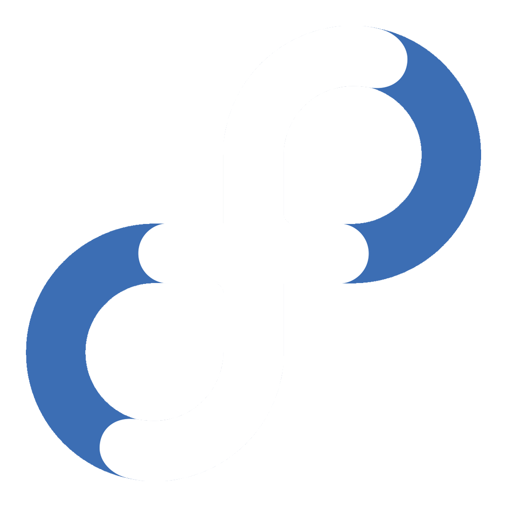
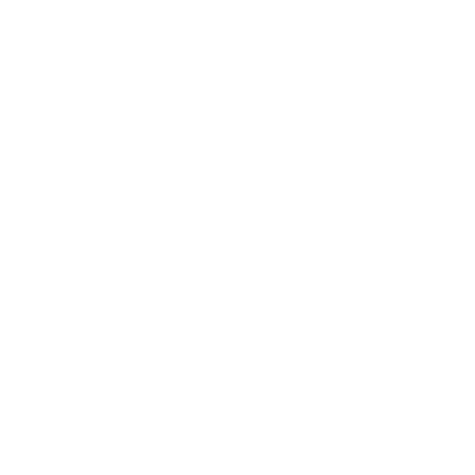
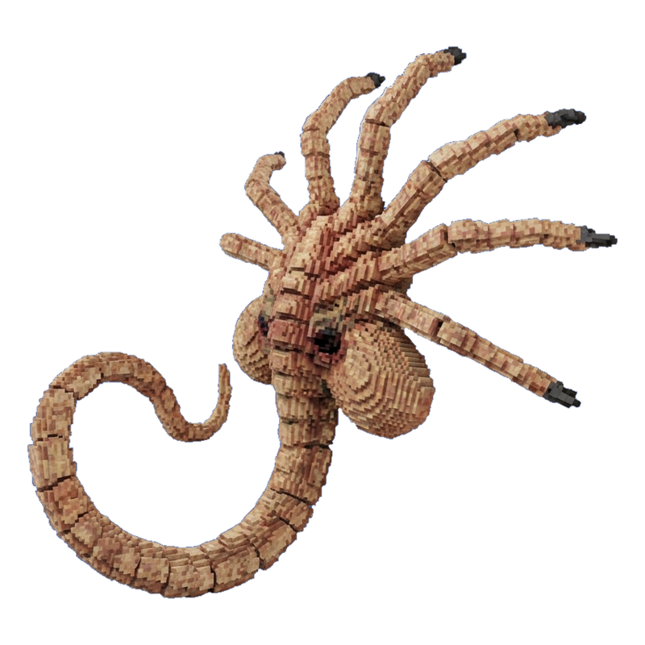
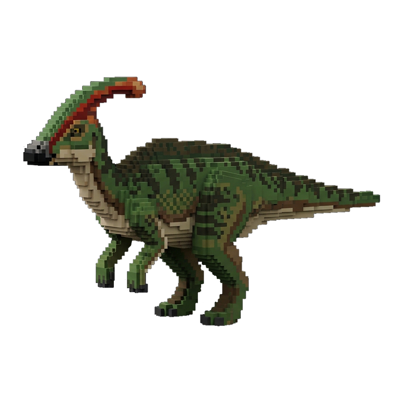
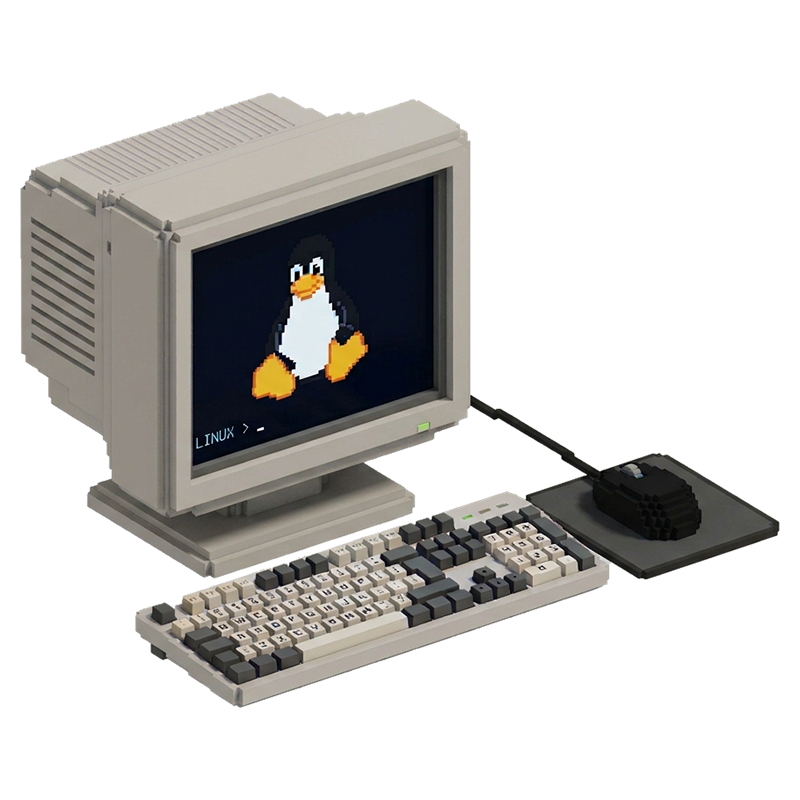
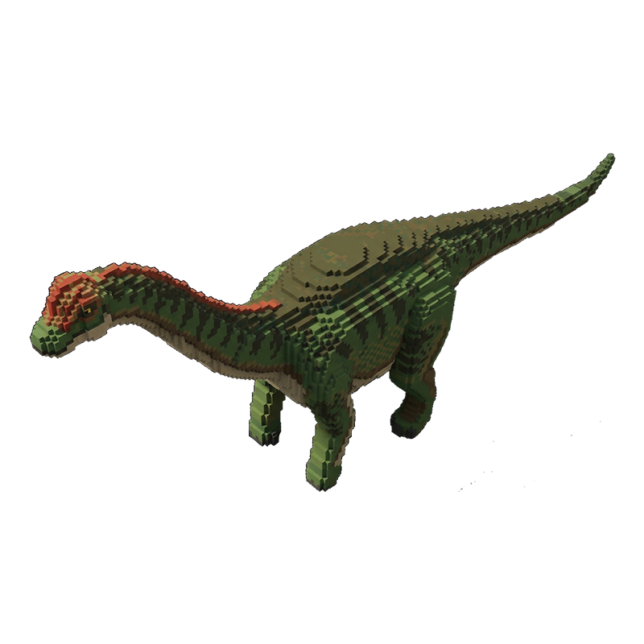
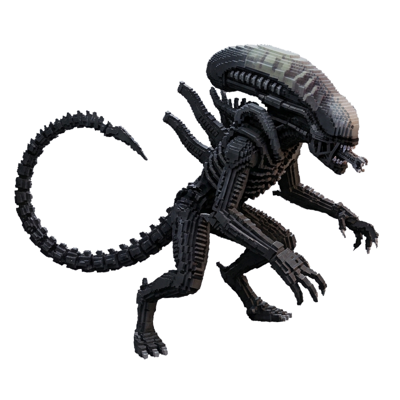

# Fastfetch   

<h3 align="left">
Welcome to my fastfetch config presets repository
</h3>

[Fastfetch](https://github.com/fastfetch-cli/fastfetch) is a command-line tool used to display system information and hardware specs alongside ASCII art or an image. Fastfetch is a modern replacement for the discontinued Neofetch.

## Config Gallery

For privacy, I remove username and IP address address modules in my configs.

<table>
  <tr>
    <td width=25%></td>
    <td width=25%></td>    
  </tr>
  <tr>
    <td width=25%></td>
    <td width=25%></td>    
  </tr>
  <tr>
    <td width=25%></td>
    <td width=25%></td>    
  </tr>
</table>

## Logo Gallery

All images created or modified by me and are .png with transparent backgrounds.

<table>
  <tr>
    <td width=25%></td>
    <td width=25%></td>
    <td width=25%></td>
    <td width=25%></td>
  </tr>
  <tr>
    <td width=25%></td>
    <td width=25%></td>
    <td width=25%></td>  
    <td width=25%></td>
  </tr>
  <tr>
    <td width=25%></td>
    <td width=25%></td>
    <td width=25%></td>
    <td width=25%></td>
  </tr>
  <tr>
    <td width=25%></td>
    <td width=25%></td>
    <td width=25%></td>
    <td width=25%></td>
  </tr>
</table>

## Usage

<u>Config files</u>: copy the chosen config file in /home/username/.config/fastfetch/, ensure the file name is config.jsonc

<u>Fonts</u>: [Jetbrains Mono NerdFont](https://www.jetbrains.com/lp/mono/) is required to display ligatures properly. Terminals such as Ghostty, Kitty and Alacritty can render NerdFont ligatures. Check your terminal  documentation to confirm that it supports NerdFont ligatures.

<u>Logos</u>: Ensure your .png image is in /home/username/.config/fastfetch/ . The images I use are 1:1 aspect ratio (ie, square), but you can choose any size you want. Depending on your chosen .png image, you may need to play with padding values in the config until you have the alignment you want.